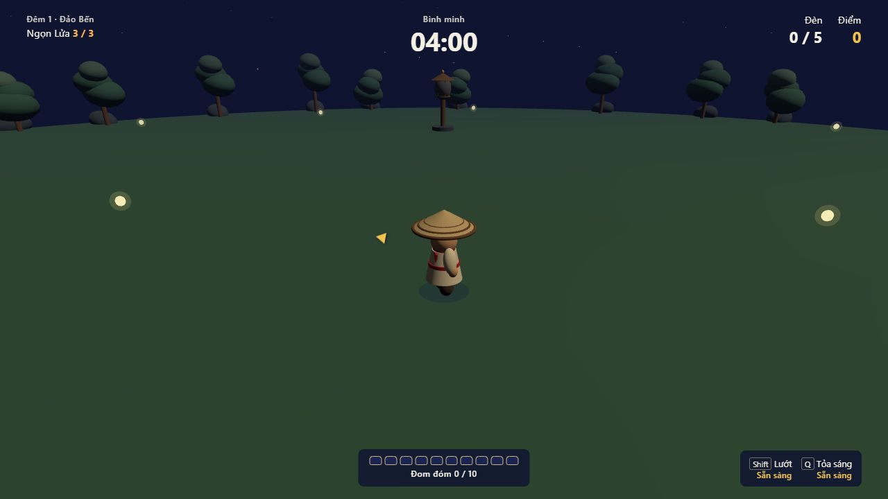

# Đảo Đèn Lồng

Game sinh tồn góc nhìn thứ ba trên ba hòn đảo. Thu thập đom đóm, giữ đèn sáng tới bình minh và sống sót qua ba Đêm.



## Yêu cầu hệ thống

- Node.js 22.12 trở lên
- Trình duyệt Chromium hoặc Edge hỗ trợ WebGL 2
- Benchmark tự động cần cài Edge/Chrome; có thể đặt `BROWSER_PATH` nếu trình duyệt nằm ở vị trí khác

## Cài và chạy

Từ thư mục repo, chạy ba lệnh:

```sh
npm ci
npm run build
npm start
```

Mở <http://127.0.0.1:4173>. Server chỉ lắng nghe trên máy cục bộ theo mặc định. Điểm leaderboard được lưu tại `data/leaderboard.json`, tồn tại qua lần chạy lại và không được đưa vào Git.

## Điều khiển

WASD di chuyển, chuột xoay POV, Space nhảy, Shift lướt, E nạp đèn, Q Tỏa Sáng, P hoặc Esc tạm dừng. Cài đặt cho phép đổi phím, chỉnh âm lượng/độ nhạy, bật giảm chuyển động, chữ lớn và bảng màu dễ phân biệt.

Mỗi Đêm kéo dài 240, 270 hoặc 300 giây. Đèn sáng hao một dầu mỗi giây; có thể nạp thêm bằng đom đóm. Thắng Đêm khi tới bình minh với ít nhất 60% đèn còn sáng. Mỗi Đêm thắng cộng điểm vào tổng chiến dịch. Khi bị đánh hoặc mất đom đóm, màu nhân vật Mây đổi ngắn để báo sự kiện, không bật popup. Sau khi thua hoặc thắng Đêm 3, có thể lưu tên 3–12 ký tự ASCII chữ/số/gạch dưới lên leaderboard top 10.

## Kiểm thử và CLI headless

```sh
npm test
node dist-cli/headless.js --seed 7 --night 1 --ticks 14400 --out dem-1.jsonl
```

Contract v1.3 giữ định dạng JSONL headless của Phase 1–3. Soak chạy 10 Đêm trong cùng tiến trình và mô phỏng các phím theo seed:

```sh
npm run soak -- --seed 7 --nights 10 --out soak.json
```

Xuất leaderboard đúng thứ tự đang lưu:

```sh
node dist-server/server.js --export-leaderboard out.json
```

## Benchmark

```sh
npm run bench -- --seed 42 --duration 30 --out bench.json
```

Runner mở cửa sổ Chromium 1280×720, dựng cảnh chuẩn 200 Bóng Mực và 100 đom đóm, chạy khởi động 3 giây rồi đo đủ thời lượng. Runner truyền cờ `--disable-gpu-vsync` và `--disable-frame-rate-limit`; phép đo máy phát triển đạt 168.8 FPS trên màn hình 60 Hz nên `vsync_off` là `true` cho lần chạy này. Trên máy khác, kiểm tra lại trường này và ghi `false` nếu driver/compositor vẫn khóa tốc độ khung hình. `peak_mem_mb` là `null`: benchmark chạy bản web và chưa đo đáng tin cậy tổng RSS của tiến trình trình duyệt cùng các tiến trình con. Đo cuối cùng để chấm điểm phải chạy trên máy do giảng viên công bố.

Benchmark tự tìm Edge/Chrome ở đường dẫn mặc định. Có thể chỉ đường dẫn khác trước lệnh:

```sh
BROWSER_PATH="/path/to/chrome" npm run bench -- --seed 42 --duration 30 --out bench.json
```

Build production tách code ứng dụng (~20 kB gzip) khỏi Three.js (~131 kB gzip) để tải song song và cache engine riêng.

## Bằng chứng và tài liệu phát hành

- `bench.json`, `soak.json` — kết quả tự chạy trên máy phát triển; không thay kết quả chấm trên máy giảng viên.
- `evidence/phase4/` — build, test, smoke test và thông tin máy.
- `ADR-03.md`, `CHANGELOG-03.md`, `CHANGELOG.md`, `CREDITS.md`, `LICENSE` — quyết định và lịch sử phát hành.
- `RETRO-04.md` — hồi tưởng qua bốn phase.
- [Gói v1.0.0](release/dao-den-long-v1.0.0.zip) — đã thử giải nén sạch; cần Node.js 22.12+ để chạy server tích hợp.

## Giấy phép

Mã nguồn dự án dùng MIT; nguồn công cụ và nội dung được ghi trong [CREDITS.md](CREDITS.md).
